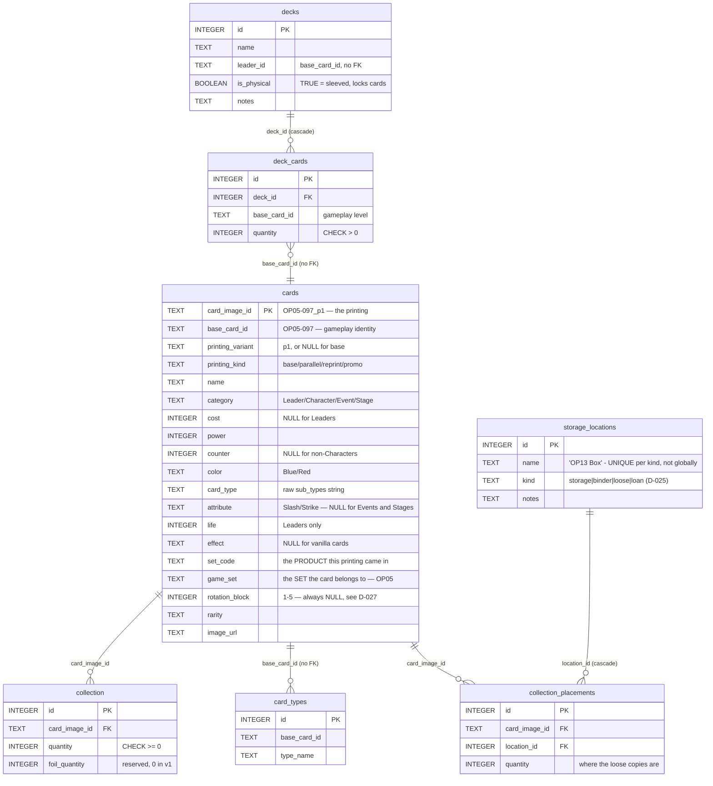
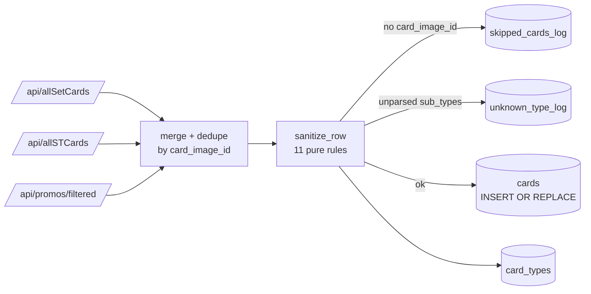

# Design Reference

What the system **is**. For *why*, see [DECISIONS.md](DECISIONS.md).
For status and how to run it, see [README.md](README.md).

Describes what's **built** — Phase 0 and Phase 1 are both complete.

> **The schema itself lives in `src/db_setup.py`** — that's the source of truth
> and it's executable. This file explains the model, not the DDL.

---

## 1. Goals

- Track inventory at **printing level** — base art, alt arts and reprints are distinct.
- Import decks from Limitless TCG paste format.
- Distinguish cards locked in sleeved decks from cards free to use.
- Show deck completion (owned vs missing) for any decklist, including decks you can't yet build.
- Run locally on one machine — not hosted, not multi-user.

**Non-goals (v1):** condition/grading, price history, hosting, multi-user,
Japanese cards, a distributable binary (D-023).

---

## 2. Tech stack

| Layer | Choice |
|---|---|
| Frontend | React + Vite, in a browser tab |
| HTTP layer | FastAPI — JSON over `localhost`, wraps the modules below |
| Logic | Python: `collection.py`, `decks.py`, `storage.py`, `resolve.py` |
| Second frontend | `cli.py` — kept, not replaced (D-024) |
| Database | SQLite |
| Card data | OptcgAPI (`https://optcgapi.com`, override with `OPTCG_API_BASE`) |

Tauri was dropped before the UI started — see **D-023** for why, and what was
given up with it.

**The logic modules never present.** No `print()`, no HTTP, no formatting: they
take a connection and return dataclasses. The CLI and the web layer are both thin
callers. Anything that would put a string in front of a user belongs in `cli.py`
or `src/web/`, never in `collection.py` and its neighbours — that property is
what made D-023 cheap and it's worth keeping.

---

## 3. Core mental model

The most important distinction in the project:

| | Keyed on | Example | Used by |
|---|---|---|---|
| **Printing** | `card_image_id` | `OP05-097_p1` | Collection — the physical card in your binder |
| **Gameplay card** | `base_card_id` | `OP05-097` | Decks — the card as the rules see it |

Every printing of a card shares one `base_card_id`. A decklist never says which
printing is sleeved, because in the game they're identical.

### Printing variants

1,690 of the 4,338 printings carry a suffix, in three families: `_p1`–`_p8`
(1,106, alternate printings), `_r1`–`_r3` (328, reprints), `_pr1`–`_pr9` (256,
promos).

> **The number is an index, not a treatment.** `_p1` means "the first alternate
> printing of this card" and nothing more — what it actually *is* varies:
>
> ```
> EB01-009_p1   Just Shut Up and Come with Us!!!! (Pirate Foil)
> OP01-001_p1   Roronoa Zoro (001) (Parallel)
> OP01-008_p1   Cavendish (Box Topper)
> EB01-023_p1   Edward Weevil - EB01-023 (SP)
> ```
>
> The card's **name** is the only reliable indicator of the treatment. They also
> stack: `EB01-006_p2` is "Tony Tony.Chopper (Alternate Art) (Manga)".

Only 170 printings say "Foil" outright (Pirate Foil 80, Jolly Roger Foil 68,
Textured Foil 22). Most premium treatments are foil without saying so — Alternate
Art (476), Reprint (249), Parallel (180), SP (108), Full Art (72), Manga (40),
SPR (26). Because these each get their own `card_image_id`, **the printing
already encodes the foil**, which is why `foil_quantity` stays 0 (D-018).

**Availability is computed, never stored:**

```
available = collection.quantity − SUM(deck_cards.quantity WHERE decks.is_physical)
```

**Collection lifecycle:** when quantity hits zero, keep the row at 0. Never delete.

**Safety rule:** if a change would make available copies negative, warn and refuse.

### Availability has three forms

Which one you want depends on the question:

```
1. "What's free right now?"                    (collection browser, new decks)
   available = owned − Σ(all physical decks)

2. "Can I build this specific deck?"           (deck completion view)
   available_to_X = owned − Σ(OTHER physical decks)
   missing        = max(0, needed − available_to_X)
   ← the deck's own cards count as available to itself

3. "If I broke down deck B, could I build X?"  (Phase 6+)
   available_to_X = owned − Σ(OTHER physical decks EXCEPT B)
```

Form 2 is the subtle one — forget that a deck's own cards count toward itself and
every built deck reports as incomplete.

---

## 4. Schema



Plus four standalone tables: `known_types` (the type vocabulary),
`unknown_type_log` and `skipped_cards_log` (sync review queues), and
`app_settings` (key/value config).

`cards` also carries five `has_*` keyword booleans (`trigger`, `blocker`, `rush`,
`double_attack`, `banish`) and a `last_synced` timestamp.

**14 indexes:** `cards` on `base_card_id`, `category`, `color`, `set_code` and
each keyword boolean; `card_types` on `base_card_id` and `type_name`;
`collection_placements` on `card_image_id` and `location_id`;
`storage_locations` on `kind`.

### Where a card lives: five categories, two tables

```
Storage  ┐
Binder   │  storage_locations.kind  →  collection_placements
Loose    │
Loan     ┘
Decks    →  decks / deck_cards
```

The owner thinks of all five as places a card can be (D-025). Four are storage
kinds; **decks stay in `decks`** because a deck has a leader and a card list that
no binder has. `collection.show()` returns both halves together, so a card lookup
answers "which binder *and* which deck" in one call — the seam doesn't surface.

Because names are unique only *within* a kind, a bare name can be ambiguous.
Lookups refuse rather than guess, raising `AmbiguousLocation`; pass `kind` to
resolve it.

**No views.** Availability is computed in Python (D-009) by
`collection.show()` — `total_owned`, `committed`, `available` per *gameplay*
card — and by `decks.show_deck()`, which additionally knows that a deck never
competes with itself. The `available_cards` view was removed in D-026: at
printing level it repeated one gameplay-level commitment on every printing row.

**Two absent foreign keys are deliberate** — `base_card_id` is non-unique by
design and SQLite requires a UNIQUE/PK target. See D-006.

### How the placement numbers relate

`collection.quantity` is the single source of truth for how many you own.
Placements only say where the copies that aren't sleeved are sitting:

```
owned    = collection.quantity
in decks = Σ deck_cards.quantity for physical decks
loose    = owned − in decks
placed   = Σ collection_placements.quantity
unplaced = loose − placed
```

`placed` exceeding `loose` **warns, never blocks** — placement is gradual
bookkeeping across thousands of cards and must never gate recording ownership
(D-019).

---

## 5. Sync pipeline



4,459 raw rows collapse to 4,338 unique printings — the same printing
legitimately appears in more than one endpoint. Re-running must never duplicate.

---

## 6. Sanitization rules

Pure functions in `src/sanitize.py` — no DB access, no side effects, one per rule.

| # | Function | Does |
|---|---|---|
| 1 | `normalize_null` | `"NULL"`, `"?"`, `""`, `"-"`, whitespace → `None` |
| 2 | `to_int` | Safe string→int; null-likes → `None` |
| 3 | `normalize_counter` | Int for Characters; forced `NULL` otherwise |
| 4 | `normalize_colors` | `"Blue Red"` → `"Blue/Red"` |
| 5 | `normalize_attributes` | `"Slash Special"` / `"Slash / Special"` → `"Slash/Special"`; unknown tokens dropped |
| 6 | `parse_subtypes` | Longest-match against `known_types` → `(matched, leftover)` |
| 7 | `extract_printing_variant` | `"OP05-097_p1"` → `"p1"`; base printing → `None` |
| 8 | `detect_keywords` | Substring-matches the five bracketed keywords |
| 9 | `repair_field_shift` | Fixes upstream rows with power/sub_types misaligned (D-013) |
| 10 | `normalize_card_image_id` | Strips file extensions, folds `-variant` → `_variant` (D-014) |
| 11 | `strip_printing_suffix` | `"P-029_r1"` → `"P-029"` — the gameplay identity (D-014) |
| 12 | `normalize_life` | Int for Leaders; forced `NULL` otherwise |
| 13 | `game_set_from_id` | `"OP05-006"` → `"OP05"` — the set, from `base_card_id` |
| 14 | `printing_kind` | `"r1"` → `"reprint"`; `None` → `"base"` |

**Id collisions are resolved before sanitizing** (`src/collisions.py`, pure,
D-029). The API reuses `card_image_id` for physically different printings —
118 ids in the current feed. `resolve_collisions` keeps the id on the base row
(plain image name, matching set, non-promo feed), gives every other row a unique
id — from its image filename when that carries a real `_p1`/`_r1`, else a slug
of what its name adds (`OP01-016_alternate_art`) — and copies the **gameplay
fields from the base row** onto them, because the same id is the same card.
Exact duplicate rows collapse to one. Re-identified rows carry
`_base_card_id`/`_printing_variant`/`_printing_kind` so the suffix rules aren't
asked to parse a synthesised id.

**Sync-level behaviors** (in `sync.py`, not pure functions): rows with no
`card_image_id` go to `skipped_cards_log`; sub-types that don't fully parse go to
`unknown_type_log`; every row is stamped `last_synced`; `image_url` is stored
exactly as returned; vanilla cards are valid so `effect` is never `NOT NULL`.

**Attribute is a closed set** — `Slash`, `Strike`, `Ranged`, `Special`,
`Wisdom`. Unlike sub-types it doesn't grow per set, so `normalize_attributes`
validates against it and drops anything else. That is what clears the three junk
values the API serves: `"?"`, `"N/A"`, and `"Straw Hat Crew ODYSSEY"` — a trait
string in the attribute slot on `OP09-033`.

**Set and product are two different fields** (D-028). `set_code` is what the
API sends and names the *product* a printing came in; `game_set` is derived
from `base_card_id` and names the *set the card belongs to*. A reprint of an
OP05 card in the PRB-01 booster is `game_set='OP05'`, `set_code='PRB-01'` —
both true. Filter and compute rotation on `game_set`; `set_code` answers
"which box did this come out of".

**Printing kind is derived, not sent.** `printing_kind` classifies the variant
suffix — `base` (2,648), `parallel` (1,150), `reprint` (338), `promo` (319) —
so the alt-art axis is queryable instead of encoded in a string suffix. `pr` is
tested before `p`, or every promo would read as a parallel.

**`rotation_block` is never populated by sync.** Block isn't in the API at all;
it comes from a hand-maintained mapping in `src/rotation.py` that ships empty.
See D-027.

**Sub-type parsing gotcha:** longest-match matters. `"Neo Navy"` must be matched
before `"Navy"`, or you get a false `Navy` plus `"Neo"` as leftover.
`parse_subtypes` sorts known types by length descending for exactly this reason.

---

## 7. OptcgAPI reference

There is **no** `/api/allCards/` and **no** `/api/allPromoCards/` — both 404.

| Endpoint | Returns |
|---|---|
| `/api/allSetCards/` | Booster set cards (bare JSON array) |
| `/api/allSTCards/` | Starter deck cards (bare JSON array) |
| `/api/promos/filtered/?rarity=PR` | Promo cards |
| `/api/sets/card/{card_id}/` | Single card, for debugging |

Field names differ from what you'd guess — `FIELD_ALIASES` in `sync.py` maps them:

| API field | → | Column |
|---|---|---|
| `card_image_id` | → | `card_image_id` (PK) |
| `card_set_id` | → | `base_card_id` (suffix-stripped) |
| `card_name` | → | `name` |
| `card_type` | → | `category` |
| `card_cost` / `card_power` | → | `cost` / `power` |
| `counter_amount` | → | `counter` |
| `card_color` | → | `color` |
| `sub_types` | → | parsed into `card_types` |
| `card_text` | → | `effect` |
| `set_id` | → | `set_code` |
| `card_image` | → | `image_url` |

**The API lags the real game** — currently ends at OP16 while the game is at
OP17. Not a bug in this code.

---

## 8. Working principles

- **Schema first.** Get the schema right before writing application code.
- **Logic before presentation.** The modules hold the rules; the CLI and the web
  layer are both thin callers that only format. Neither owns behaviour.
- **Log don't crash.** Bad API rows go to log tables, never exceptions.
- **Idempotent sync.** Running it twice must not duplicate data.
- **Pure sanitization.** `sanitize.py` never touches the DB.
- **No DON cards.**

---

## 9. Roadmap

Re-cut on 2026-09-15 around one sentence (D-024):

> *I open the app, see my real cards with images, know where each one is, and can
> check a decklist against what I own.*

| Phase | Description | Status |
|---|---|---|
| 0 | Data foundation — schema + OptcgAPI sync | ✅ Complete |
| 1 | Collection + decks (CLI) — import, storage locations | ✅ Complete |
| 2 | **MVP — the app you actually use** ([PHASE_2.md](PHASE_2.md)) | ← current |
| 3 | Insights — cross-deck views, what-can-I-build | |
| 4 | Interactive deck builder | |
| 5 | Polish — local image cache, hover previews | |
| 6+ | Future ideas (below) | |

Phase 2 is five milestones: real data in (no code), card browser, locations,
decks & completion, fast loose-card entry.

What moved and why: the old Phase 2 was CLI-only insights that the UI would have
replaced, so it became Phase 3 and will be built as UI. Images moved out of
Phase 5 into the MVP — `image_url` is already on every row, so showing a card is
an `` tag; only the *local cache* is still Phase 5 work.

---

## 10. Deferred / out of scope

**Wanted eventually, no schema support yet:** cannibalization analysis
(availability form 3), "decks I could build with N more cards", trade tracking,
win/loss and last-played per deck, deck tags/archetypes, format flag,
trigger-text parsing for filterable search, DON!! cards, JP-exclusive cards,
price history, multiple physical owners.

**Hook exists:** local image cache (Phase 5), auto-detection of new sub-types
(currently a manual `unknown_type_log` review), foil-vs-non-foil usage
(`foil_quantity` lands in Phase 1 but stays 0 — see §3 "Printing variants").

**Never:** hosting, multi-user, auth, condition/grading, playtesting/simulation.
